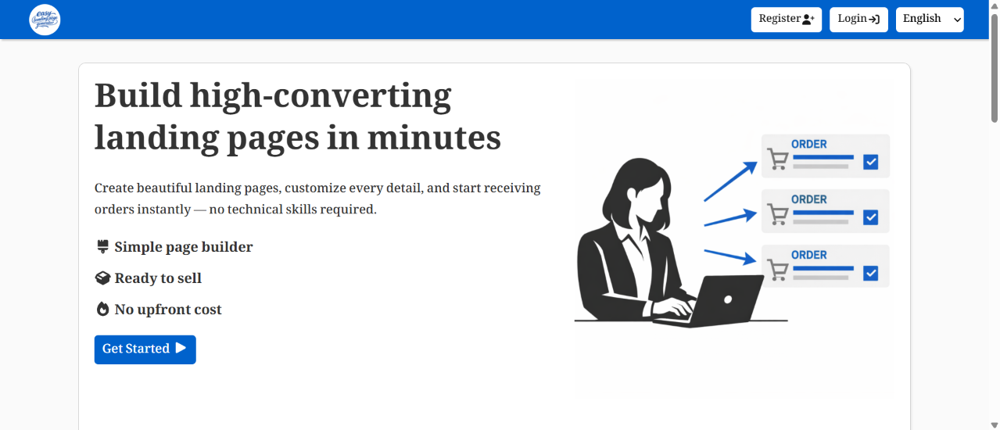
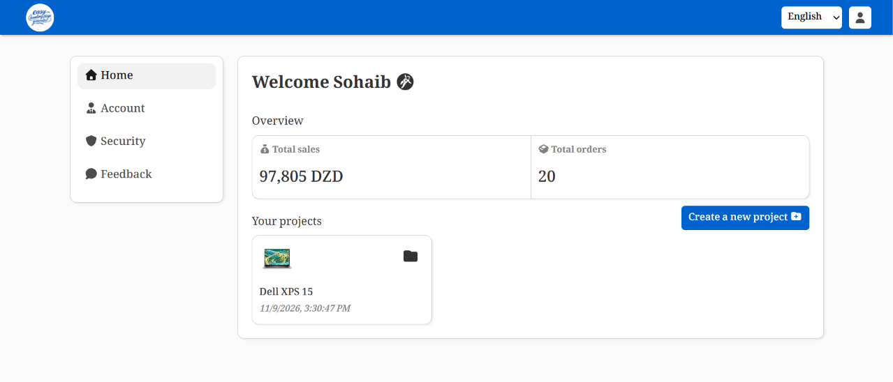
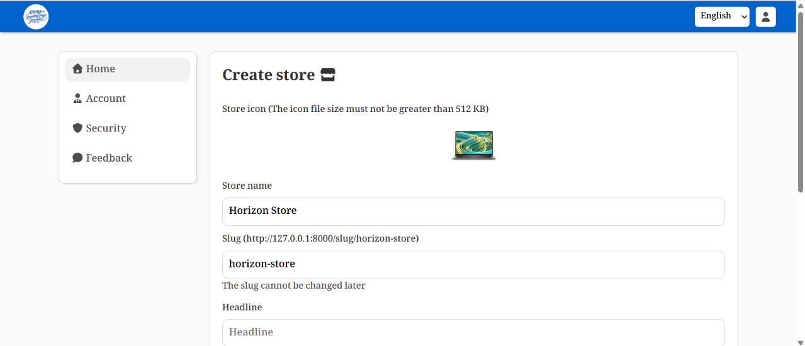
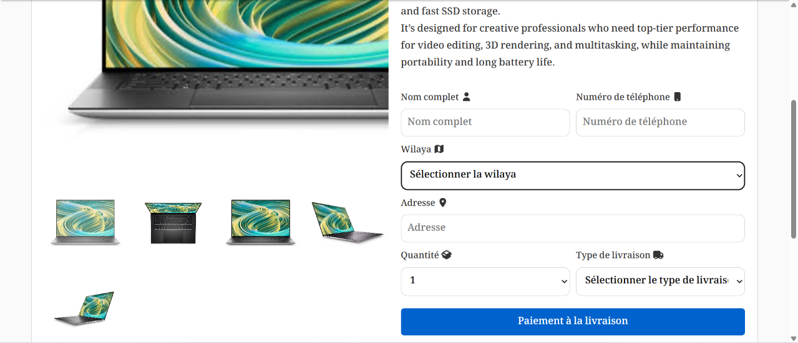
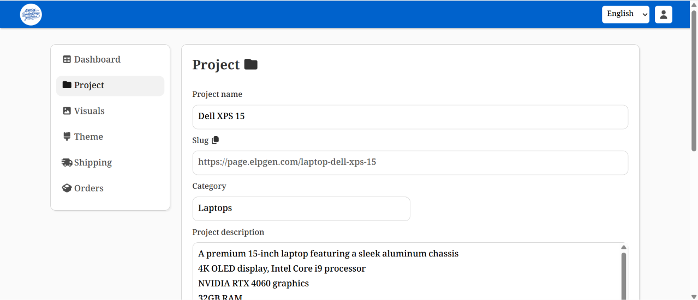
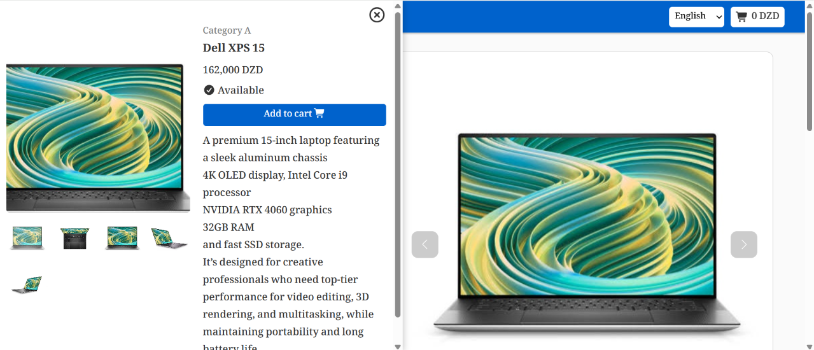
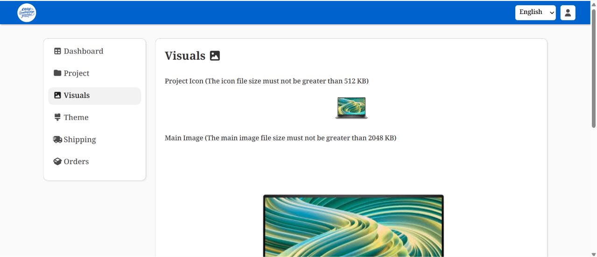

# Easy Landing Page and Store Generator

Easy Landing Page and Store Generator is an all-in-one e-commerce platform designed to help online sellers, merchants, and direct-to-consumer businesses launch high-converting single-product landing pages and complete multi-product online stores in minutes.

The platform streamlines the transition from product idea to sales generation by eliminating technical hurdles. It provides an intuitive interface for managing products, designing custom storefront visuals, tracking customer orders throughout their entire lifecycle, and configuring region-specific shipping rates tailored for Cash On Delivery markets.

---

## Key Benefits and Purpose

Traditional e-commerce setups require managing complicated plugins, external checkout funnels, and disconnected inventory systems. Easy Landing Page and Store Generator unifies these operational requirements into a single modern web application.

- Rapid Funnel Creation: Launch targeted landing pages for specific marketing campaigns and paid ad promotions with zero coding.
- Dual Operating Modes: Choose between a focused single-product landing page or a full-scale multi-product storefront with category browsing and cart drawers.
- Cash On Delivery Optimization: Built specifically to support Cash On Delivery operations, featuring fast checkout forms with minimum friction and direct province-level delivery selection.
- Regional Shipping Coverage: Pre-configured support for all Algerian administrative provinces (wilayas), allowing merchants to define custom shipping fees or offer free shipping per region.
- Order Lifecycle Management: Real-time monitoring and status management for orders from initial placement through processing, shipment, delivery, cancellation, or return.
- Integrated Visual Customization: Instant personalization of colors, logos, promotional banners, image carousels, and typography without touching template source code.
- Multi-Language Ready: Native database structure and interface support for Arabic, French, and English users.
- Security and Multi-Device Session Control: Robust authentication, rate limiting on sensitive submission endpoints, and remote device logout capabilities.

---

## Visual Overview and Screenshots

The platform offers a clean and responsive user interface across all management workflows and customer-facing pages.

### Welcome and Presentation Interface

The front-facing portal introduces the generator capabilities, guiding merchants through registration and project onboarding.

### Store Creation Wizard

Merchants can configure store branding, select primary languages, set up initial product catalogs, and choose default shipping policies with an easy step-by-step setup form.

### High-Converting Single Product Landing Page

Generated landing pages feature an attention-grabbing hero section, media carousels, highlighted product specifications, trust badges, customer reviews, and an inline fast-checkout form.

### Project Operations and Settings Center

From the project workspace, administrators can configure project details, adjust theme styling, manage shipping rules, and review order transactions.

### Multi-Product Storefront

The storefront interface offers intuitive category filtering, product grid layouts, product search, rich detail modals, and an interactive slide-out shopping cart.

### Visual Asset and Media Customizer

Merchants can upload store logos, hero sliders, secondary promotional graphics, and background artwork directly from their browser.

---

## Core System Modules

### 1. Single-Product Landing Page Engine
Tailored for direct-response marketing. Each project generates a dedicated, distraction-free landing page with dynamic URL slugs, Meta Pixel tracking integration, high-resolution media galleries, and direct one-click order submissions.

### 2. Multi-Product Store Engine
Designed for brands managing broader catalogs. Includes category organization, product variants, inventory stock tracking, discounted price displays, and an interactive cart drawer with real-time total recalculations.

### 3. Order Management System
Every incoming purchase is captured with full customer contact details, destination province, requested quantity, and shipping notes. Store managers can filter orders by status:
- Pending
- Processing
- Shipped
- Delivered
- Canceled
- Returned

### 4. Regional Shipping Engine
The platform includes built-in regional shipping management covering all 58 administrative provinces of Algeria. Merchants can toggle free shipping globally, activate or deactivate specific regions, and assign customized delivery rates per province.

### 5. Theme and Visual Styler
Store aesthetics can be adapted to match brand identities. Operators can select color schemes, customize button styles, change background accents, and upload promotional image sliders.

### 6. Security and Session Management
Built with robust security protections including route throttles to prevent form spam, encrypted password handling, and active session monitoring allowing users to log out of other devices remotely.

---

## Technology Stack

The application is built on modern, performant, and production-tested technologies across the full stack.

### Backend Architecture
- Laravel 11: The foundation web framework providing expressive routing, Eloquent ORM, robust validation, and migration tooling.
- PHP 8.2: Leveraging modern PHP language features, strict typing, and high execution speed.
- Inertia.js Laravel Adapter: Bridges Laravel backend routing directly with modern client-side React components without building a separate REST or GraphQL API layer.
- Redis and Predis: In-memory data store integration for rapid session handling and caching.
- Jenssegers Agent: Device, browser, and platform detection for responsive presentation and session auditing.
- Ziggy: Enables seamless usage of named Laravel routes inside JavaScript files.

### Frontend Architecture
- React 19: Modern declarative component architecture for building reactive user interfaces.
- Inertia.js React: Provides single-page application feel with classic server-driven routing and data passing.
- Vite 5: Fast modern frontend build tool and module bundler with instant Hot Module Replacement during development.
- Swiper: Touch-friendly mobile and desktop image slider used for product showcases and hero carousels.
- FontAwesome React: Comprehensive icon system for dashboard navigation, badges, and interface controls.
- Axios: Promise-based HTTP client for asynchronous background requests.

### Database and Storage
- Relational Database (MySQL, MariaDB, or SQLite): Schema structured around users, projects, stores, products, categories, orders, order items, regions, and themes.
- Laravel Storage: Dedicated file system driver managing uploaded product pictures, store logos, and promotional graphics.

### Quality and Testing Infrastructure
- Laravel Pint: Automated PHP code style fixer and linter ensuring adherence to clean code standards.
- ESLint: Static code analysis for JavaScript and JSX code quality and error prevention.
- PHPUnit: Unit and feature testing framework for core application workflows.
- GitHub Actions: Automated continuous integration pipeline running syntax checks, style linting, and build verification on push and pull requests.

---

## Local Verification Commands for Windows

To verify code quality locally in a Windows environment, use the following tools:

### PHP Syntax Check
Run this command in Windows PowerShell to verify syntax across all project PHP files without errors:

Get-ChildItem -Path app, bootstrap, config, database, routes, tests -Filter *.php -Recurse | ForEach-Object { $output = php -l $_.FullName; if ($LASTEXITCODE -ne 0) { Write-Host $output } }

### PHP Code Style Check with Laravel Pint
To inspect PHP code formatting against standard style guidelines:

vendor\bin\pint --test

To automatically format and fix PHP styling issues:

vendor\bin\pint

### JavaScript and JSX Code Style Check with ESLint
To analyze JavaScript and JSX components for styling and syntax issues:

npx eslint resources/js

To automatically fix auto-correctable JavaScript issues:

npx eslint resources/js --fix

### Frontend Build Verification
To ensure all JSX modules, assets, and React dependencies compile properly:

npm run build

---

## Deployment Summary

1. Configure environment variables in the .env configuration file, including application URL, database credentials, and session driver.
2. Generate an application encryption key using artisan key:generate.
3. Run database migrations and seeders using artisan migrate --seed.
4. Create the public storage symlink using artisan storage:link to expose media uploads.
5. Compile frontend production assets using npm run build.
6. Configure web server document root to point to the public directory.
